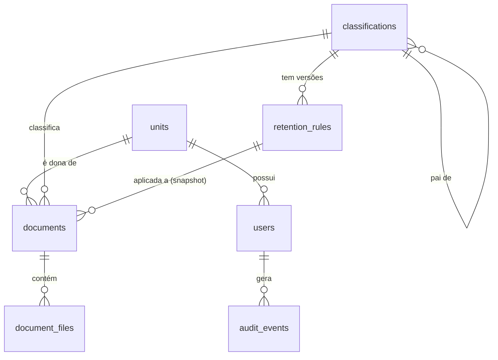

# Arquiva

[](https://github.com/natamuniz/arquiva/actions/workflows/ci.yml)

API open-source de **gestão documental** em Laravel 13 e PostgreSQL 16. Modela regras de negócio reais de arquivologia: plano de classificação hierárquico, tabela de temporalidade versionada, controle de acesso por sigilo, trilha de auditoria imutável e verificação de integridade dos arquivos (fixidez).

> Projeto de portfólio, escrito do zero com dados 100% fictícios.

## O problema

Órgãos e empresas precisam guardar documentos por prazos definidos em lei, saber quem pode ver cada um, provar que nada foi adulterado e responder "quem fez o quê, quando". Um CRUD com upload não resolve isso: as regras mudam com o tempo, o acesso depende do sigilo e da unidade, e banco e disco precisam ficar consistentes mesmo quando algo falha no meio.

## Funcionalidades

- **Autenticação por token** (Sanctum) com expiração de 24 h e limite de 5 tentativas de login por minuto.
- **Quatro perfis** (`admin`, `gestor`, `operador`, `consulta`) e usuários ligados a uma unidade.
- **Sigilo em dois níveis:** ver os metadados (público ou da própria unidade) é diferente de baixar o arquivo (credencial ≥ sigilo).
- **Plano de classificação** em árvore (`010 > 010.1 > 010.1.1`), com consulta recursiva, desativação em vez de exclusão e importação CSV tudo-ou-nada com erros por linha.
- **Tabela de temporalidade versionada:** alterar uma regra cria nova versão e encerra a anterior; dá para perguntar qual regra valia em qualquer data.
- **Ciclo de vida do documento:** rascunho → capturado. A captura lista todas as pendências de uma vez e guarda a versão da regra vigente (snapshot).
- **Arquivos privados** com SHA-256, processamento em fila (tipo real do conteúdo, páginas do PDF) e download só pela API.
- **Fixidez diária:** recalcula o hash de todos os arquivos em lotes e registra corrupção ou ausência.
- **Auditoria imutável** de alterações, logins, falhas de login e downloads.
- **Busca** por texto sem diferenciar acentos (`licitacao` encontra "Licitação"), por classe incluindo descendentes, sigilo, status e período.

## Decisões técnicas

Cada decisão abaixo tem teste que a comprova.

| Decisão | Por quê |
|---|---|
| **Índice único parcial** `UNIQUE (classification_id) WHERE valid_to IS NULL` | Garante no banco uma única regra vigente por classe. A validação da aplicação sozinha perde em condição de corrida; o índice não. A violação vira 409. |
| **Snapshot da regra na captura** | O documento guarda o `retention_rule_id` da versão vigente. Mudar a regra depois não altera documentos já capturados. |
| **Banco antes do disco** | Exclusões removem o registro na transação e só apagam o arquivo físico depois do commit (`DB::afterCommit`). Se a transação falhar, o arquivo continua lá. No upload, se o banco falhar, o arquivo recém-gravado é removido. |
| **Jobs despachados após o commit** | O worker nunca busca um registro que ainda não foi gravado. |
| **404 para o que você não vê, 403 para o que você vê mas não pode fazer** | A visibilidade é aplicada na busca do documento pela rota. Um documento sigiloso de outra unidade responde 404 em qualquer rota, sem revelar que existe. |
| **Tipo do arquivo validado em dois momentos** | No upload, só extensão e tamanho (resposta rápida). No job, o conteúdo real pela assinatura do arquivo e a leitura do PDF. |
| **Código e pai de classe imutáveis** | Mudar o pai exigiria recalcular a subárvore e afetaria documentos já classificados. Reestruturar = criar classes novas e desativar as antigas. |
| **Hierarquia por `parent_id` + CTE recursiva** | Simples e suficiente para o volume. Evolução possível: `ltree` ou nested set. |
| **Auditoria por Observers + model imutável** | Toda alteração de model auditável vira evento com só os campos alterados. `AuditEvent` lança exceção em `update` e `delete`, e não existe rota de escrita. |
| **Trilha respeita o sigilo** | Um gestor não vê na trilha geral os eventos de documentos que ele não pode ver (os valores antes/depois vazariam o conteúdo). |
| **Busca com `unaccent` + `ILIKE`** | Usuários digitam sem acento. O `%` e o `_` digitados são tratados como texto. |
| **Fila com driver `database`** | Sem Redis para subir o projeto. Trocar de driver é só configuração. |
| **Larastan nível 8** | Inclui a checagem de `literal-string`: nenhum SQL bruto da aplicação recebe texto vindo da requisição. |

## Modelo de dados



## Como rodar

Requisito: Docker com Docker Compose.

```bash
git clone https://github.com/natamuniz/arquiva.git
cd arquiva
docker compose up -d
```

A primeira subida instala as dependências, roda as migrations, popula o banco com dados fictícios e gera a documentação. Acompanhe com `docker compose logs -f app`.

- API: <http://localhost:8080/api/v1>
- Documentação interativa: <http://localhost:8080/docs>
- OpenAPI: [`docs/openapi.yaml`](docs/openapi.yaml)

Containers: `app` (php-fpm), `nginx`, `postgres`, `queue` (worker da fila) e `scheduler` (fixidez e limpeza diárias).

### Usuários de teste

Senha de todos: `password`.

| E-mail | Perfil | Unidade | Credencial |
|---|---|---|---|
| admin@arquiva.test | admin | Presidência | sigiloso |
| gestor.adm@arquiva.test | gestor | Diretoria Administrativa | sigiloso |
| operador.adm@arquiva.test | operador | Diretoria Administrativa | restrito |
| consulta.adm@arquiva.test | consulta | Diretoria Administrativa | publico |
| operador.jur@arquiva.test | operador | Assessoria Jurídica | sigiloso |

### Teste rápido

```bash
# Login
TOKEN=$(curl -s -X POST localhost:8080/api/v1/auth/login \
  -H 'Content-Type: application/json' -H 'Accept: application/json' \
  -d '{"email":"consulta.adm@arquiva.test","password":"password"}' | jq -r .token)

# Busca sem acento
curl -s "localhost:8080/api/v1/documents?q=licitacao" -H "Authorization: Bearer $TOKEN" | jq '.data[].title'

# O perfil consulta vê o documento sigiloso da própria unidade, mas não baixa o arquivo (403)
curl -s "localhost:8080/api/v1/documents?secrecy=sigiloso" -H "Authorization: Bearer $TOKEN" | jq '.data[0].id'
```

## Endpoints

| Método e rota | O que faz |
|---|---|
| `POST /auth/login` · `POST /auth/logout` · `GET /auth/me` | Autenticação |
| `GET /classifications` · `GET /classifications/{id}/tree` | Plano em árvore e subárvore |
| `POST /classifications` · `PATCH` · `DELETE` | Criar, renomear e excluir classe |
| `POST /classifications/{id}/deactivate` · `/activate` | Desativar e reativar |
| `POST /classifications/import` | Importação CSV tudo-ou-nada |
| `GET /classifications/{id}/retention-rules?at=AAAA-MM-DD` | Histórico de regras ou regra vigente na data |
| `POST /classifications/{id}/retention-rules` · `PUT /retention-rules/{id}` | Primeira regra e nova versão |
| `GET /documents` · `POST` · `GET /documents/{id}` · `PATCH` · `DELETE` | Busca, rascunho, detalhe, edição e exclusão |
| `POST /documents/{id}/capture` · `GET /documents/{id}/history` | Captura e histórico |
| `POST /documents/{id}/files` · `GET /files/{id}/download` | Upload e download auditado |
| `POST /files/{id}/reprocess` · `DELETE /files/{id}` | Reprocessar e remover arquivo do rascunho |
| `GET /audit-events` | Trilha geral (admin e gestor) |

Todas as rotas têm o prefixo `/api/v1`. Detalhes e exemplos em `/docs`.

## Testes e qualidade

```bash
docker compose exec app vendor/bin/pest                 # 160+ testes com PostgreSQL de verdade
docker compose exec app vendor/bin/pint --test          # estilo
docker compose exec app vendor/bin/phpstan analyse      # Larastan nível 8
```

- Todo cenário das specs tem pelo menos um teste Feature. Testes de autorização cobrem permitido e negado.
- Os testes usam PostgreSQL, não SQLite, para validar o índice parcial, a CTE recursiva e o `unaccent`.
- Testes de arquitetura (Pest `arch()`) garantem, por exemplo, que as regras de negócio em `app/Actions` não dependem da camada HTTP.
- A CI no GitHub Actions roda Pint, Larastan e Pest a cada push.

## Organização do código

```
app/
  Actions/      regras de negócio (uma ação por caso de uso)
  Enums/        perfis, sigilo, status, destinação
  Http/         controllers finos, Form Requests e API Resources
  Jobs/         processamento de arquivos e fixidez
  Observers/    auditoria automática
  Policies/     permissões por perfil e unidade
openspec/       especificação do projeto (fonte da verdade)
tests/          Feature, Unit e Arch (Pest)
```

## Próximos passos

- Calcular os prazos de cada documento (fim da fase corrente e da intermediária) e listar os elegíveis para eliminação ou recolhimento.
- Tornar a auditoria à prova de adulteração no banco: trigger que bloqueia `UPDATE`/`DELETE` e hash encadeado entre eventos.
- Armazenamento S3-compatível (MinIO no Docker Compose).
- Busca full-text com `tsvector` em português.
- Frontend em Vue/Inertia (change `add-web-ui`).

## Licença

MIT.
