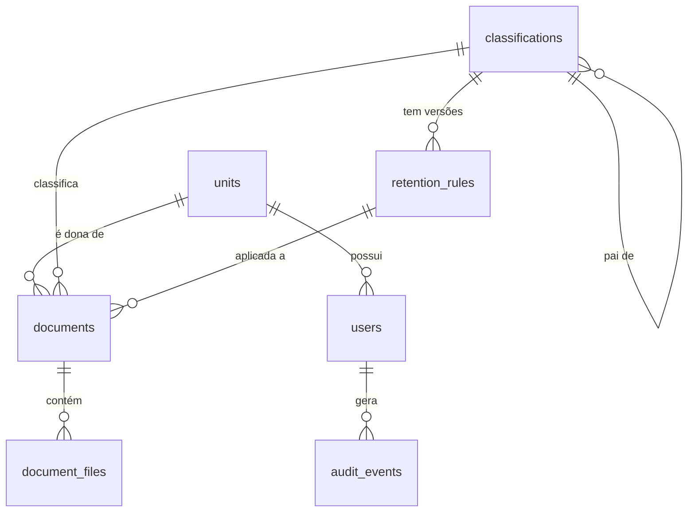

## Context
Projeto de portfólio. O objetivo é que um recrutador ou entrevistador consiga, em poucos minutos, subir o projeto, ler o README e encontrar decisões técnicas bem justificadas.

## Goals / Non-Goals
- Goals: regras de negócio corretas e testadas; autorização granular; integridade banco + disco; fila real; projeto que sobe com um comando.
- Non-Goals: interface web, OCR, performance em larga escala, multi-tenant.

## Modelo de dados

| Tabela | Colunas principais |
|---|---|
| `units` | id, name, code (único) |
| `users` | id, name, email, password, role (enum), unit_id, clearance (enum sigilo) |
| `classifications` | id, code (único), name, parent_id (nullable), depth, active |
| `retention_rules` | id, classification_id, version, current_years, intermediate_years, final_destination (enum), notes, valid_from, valid_to (nullable), created_by. Únicos: `(classification_id) WHERE valid_to IS NULL` e `(classification_id, version)` |
| `documents` | id (uuid), title, subject, interested_party, produced_at, classification_id, retention_rule_id (nullable até a captura), unit_id, secrecy (enum), status (enum), captured_at, created_by, timestamps |
| `document_files` | id (uuid), document_id, original_name, storage_path, mime_type, size_bytes, sha256, processing_status (enum), page_count (nullable), failure_reason (nullable), last_fixity_check_at (nullable), fixity_ok (bool, nullable = não verificado), created_by, timestamps. Único: `(document_id, sha256)` |
| `audit_events` | id, user_id (nullable para jobs, comandos e falha de login), action, auditable_type, auditable_id, before (jsonb), after (jsonb), ip, created_at |

Todas as datas são `timestamptz` gravadas em UTC; a API devolve ISO 8601 e interpreta datas sem hora no fuso `America/Sao_Paulo`.

## Decisões
1. **Uma única regra vigente por classe** garantida no banco com índice único parcial: `UNIQUE (classification_id) WHERE valid_to IS NULL`. Isso protege contra condição de corrida, não só a validação da aplicação.
2. **Snapshot da regra no documento:** ao capturar, o documento guarda `retention_rule_id` da versão vigente. Alterar a regra depois não altera documentos já capturados.
3. **Banco antes do disco:** exclusões removem o registro dentro da transação e só apagam o arquivo físico depois do commit. Se o commit falhar, o arquivo continua lá. Uploads gravam o arquivo primeiro e, se a transação falhar, o arquivo é removido no `catch`.
4. **Auditoria via Observers** nos models auditáveis + registro explícito para eventos que não são alteração de model (download, login). O model `AuditEvent` lança exceção em `update` e `delete`.
5. **Hierarquia por `parent_id`** com consulta recursiva (CTE do PostgreSQL) para listar subárvores. Simples e suficiente para o volume do projeto.
6. **Fila com driver `database`** para não adicionar Redis. A troca de driver é só configuração.
7. **404 para o que o usuário não vê, 403 para o que ele vê mas não pode fazer.** Qualquer rota que referencia um documento invisível responde 404, para não revelar que ele existe. 403 só aparece quando o usuário enxerga o documento (por exemplo, um público de outra unidade) mas não tem permissão para a ação.
8. **Tipo do arquivo validado em dois momentos.** No upload, só a extensão e o tamanho (resposta rápida). No job, o conteúdo real (mime por assinatura e leitura do PDF). Isso mantém o upload leve e concentra a análise pesada na fila. Por isso o upload usa a regra `extensions` do Laravel, e não `mimes`/`mimetypes`, que já inspecionam o conteúdo.
9. **Código e pai de classe são imutáveis.** Mudar o pai exigiria recalcular códigos e `depth` de toda a subárvore e afetaria documentos já classificados. Só o nome é editável; uma reestruturação é feita criando classes novas e desativando as antigas.
10. **Jobs despachados depois do commit** (`afterCommit`), para o worker nunca buscar um registro que ainda não foi gravado.

## Risks / Trade-offs
- CTE recursiva não escala para árvores enormes → aceitável no escopo; mencionar no README como possível evolução (ltree / nested set).
- Verificação de fixidez lê o arquivo inteiro → executar em fila, em lotes.
- Upload grava o arquivo antes do banco; se o processo morrer entre os dois, sobra um arquivo órfão → comando `arquiva:prune-orphans` diário.
- Limite de 50 MB depende da configuração de PHP (`upload_max_filesize`, `post_max_size`) e do nginx (`client_max_body_size`) → configurar acima de 50 MB no Docker para que o limite seja aplicado pela validação do Laravel, com 422.
- Imutabilidade da auditoria só na aplicação: um `UPDATE` direto no banco não é impedido → possível evolução com trigger no PostgreSQL e hash encadeado.

## Open Questions
- Gerar um frontend Vue/Inertia em uma change futura (`add-web-ui`).
